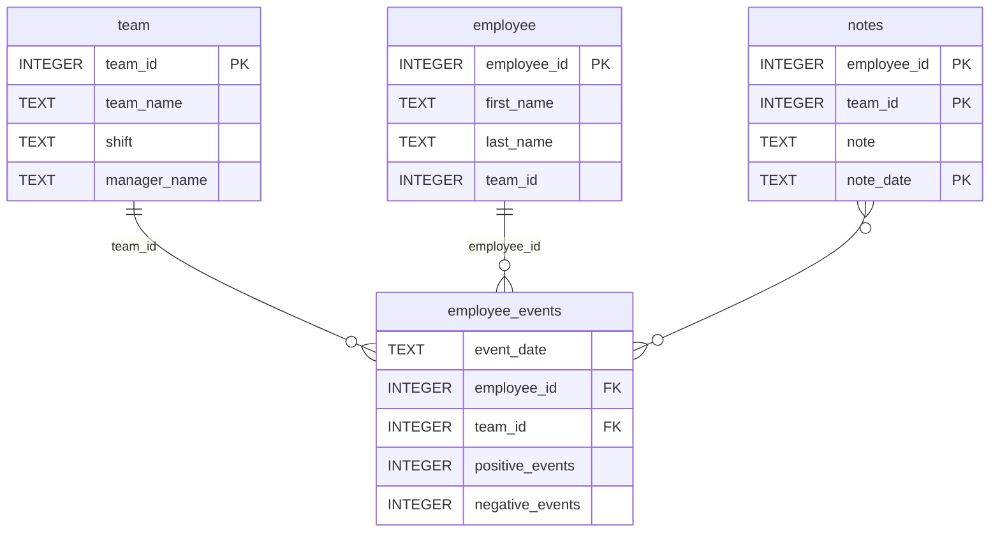

# Software Engineering for Data Scientists 

This project was developed as part of the Software Engineering for Data Scientists project.

The application provides a dashboard for monitoring employee and team performance and predicted recruitment risk.

Managers can use the dashboard to:
- View positive and negative performance events for an employee or team
- Track cumulative performance events over time
- View notes associated with an employee or team
- View the predicted likelihood of employee recruitment by another company
- View the average predicted recruitment risk for a team

The project uses a SQLite database, a custom Python package for querying employee data, a pre-trained machine learning model, and a FastHTML dashboard.

### Repository Structure
```
├── README.md
├── assets
│   ├── model.pkl
│   └── report.css
├── env
├── python-package
│   ├── employee_events
│   │   ├── __init__.py
│   │   ├── employee.py
│   │   ├── employee_events.db
│   │   ├── query_base.py
│   │   ├── sql_execution.py
│   │   └── team.py
│   ├── requirements.txt
│   ├── setup.py
├── report
│   ├── base_components
│   │   ├── __init__.py
│   │   ├── base_component.py
│   │   ├── data_table.py
│   │   ├── dropdown.py
│   │   ├── matplotlib_viz.py
│   │   └── radio.py
│   ├── combined_components
│   │   ├── __init__.py
│   │   ├── combined_component.py
│   │   └── form_group.py
│   ├── dashboard.py
│   └── utils.py
├── requirements.txt
├── start
├── tests
    └── test_employee_events.py
```

### employee_events.db


