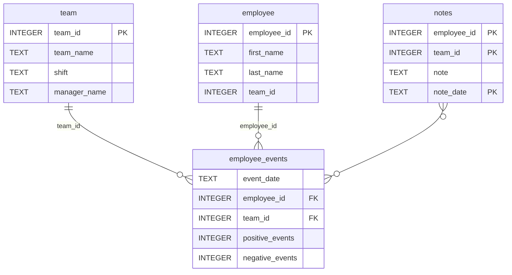

# Software Engineering for Data Scientists 

This repository contains starter code for the **Software Engineering for Data Scientists** final project. Please reference your course materials for documentation on this repository's structure and important files. Happy coding!

### Setup

Requires **Python 3.11**. Commands below are run from the project root.

```bash
# 1. Create and activate a virtual environment
python3.11 -m venv .venv
source .venv/bin/activate          # Windows: .venv\Scripts\activate

# 2. Install pinned dependencies (also installs the employee_events package)
pip install -r requirements.txt

# 3. Reinstall the package in editable mode for development
pip install -e python-package

# 4. (Optional) Rebuild the package distribution -> python-package/dist/employee_events-0.0.tar.gz
cd python-package && python setup.py sdist && cd ..
```

### Usage

```bash
# Run the dashboard, then open http://localhost:5001
python report/dashboard.py

# Run the tests and linter
pytest
flake8
```

Routes: `/` (employee 1), `/employee/<id>`, `/team/<id>`.

The `employee_events` package exposes `Employee` and `Team` query classes:

```python
from employee_events import Employee, Team

Employee().names()          # [(full_name, employee_id), ...]
Team().event_counts(1)      # DataFrame of daily positive/negative events
Team().notes(1)             # DataFrame of manager notes
Employee().model_data(1)    # DataFrame of features for the recruitment-risk model
```

GitHub Actions run `pytest` (Tests) and `flake8` (Lint) on every push and pull request to `main`.

### Repository Structure
```
├── README.md
├── assets
│   ├── model.pkl
│   └── report.css
├── env
├── python-package
│   ├── employee_events
│   │   ├── __init__.py
│   │   ├── employee.py
│   │   ├── employee_events.db
│   │   ├── query_base.py
│   │   ├── sql_execution.py
│   │   └── team.py
│   ├── requirements.txt
│   ├── setup.py
├── report
│   ├── base_components
│   │   ├── __init__.py
│   │   ├── base_component.py
│   │   ├── data_table.py
│   │   ├── dropdown.py
│   │   ├── matplotlib_viz.py
│   │   └── radio.py
│   ├── combined_components
│   │   ├── __init__.py
│   │   ├── combined_component.py
│   │   └── form_group.py
│   ├── dashboard.py
│   └── utils.py
├── requirements.txt
├── start
├── tests
    └── test_employee_events.py
```

### employee_events.db


